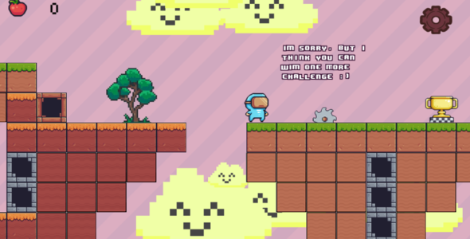

# Virtual Guy — Platform Game

[](https://virtual-guy-live-preview.netlify.app/)

A 2D side-scrolling platform game developed with Construct 2 and exported for HTML5. **Virtual Guy** is the improved evolution of an earlier 2D platform game project created in 2021, expanding the original concept with a more complete platforming experience, additional gameplay elements and a more polished presentation.

## Play Online

**[▶ Play Virtual Guy](https://virtual-guy-live-preview.netlify.app/)**

The game runs directly in the browser without requiring an installation.

## Screenshots

The screenshots below are stored directly in this repository.

<p align="center">
     
</p>

## About

Virtual Guy is a retro-inspired 2D platformer focused on exploration, platforming and avoiding hazards while progressing through its levels.

The game features **3 levels**, collectible apples, checkpoints, enemies, spikes, moving hazards, portals, bounce pads and a trophy at the end of each stage. The player must navigate the environments carefully while collecting as many apples as possible and reaching the goal.

The project is a direct evolution of the earlier **[2D Platform Game](https://github.com/coelho-anon/plataform-game---construct2)** created in 2021 as a Construct 2 study project. Virtual Guy represents a more developed version of that original platform-game experiment, with a richer level structure, more gameplay mechanics, additional assets and a more polished presentation.

## Development History

- **2021** — Original 2D platform game created as a study project with Construct 2.
- **2023** — Virtual Guy was developed as an expanded version of the platform-game concept and published as an HTML5/Construct game.
- **August 7, 2023** — The commercial Virtual Guy item was publicly listed on CodeCanyon.
- **2026** — The HTML5 export was organized and published in this GitHub repository, together with a live Netlify preview.

There is no reliable public record indicating the exact number of days or hours spent developing Virtual Guy, so the development duration is not stated as a specific number.

## Features

- 2D side-scrolling platform gameplay
- 3 playable levels
- Pixel-art visual style
- Character movement and jumping
- Collectible apples
- Checkpoints for saving progress
- Enemies and environmental hazards
- Spikes and moving obstacles
- Bounce pads
- Portals
- Trophy-based level completion
- Sound effects and background music
- Browser-based HTML5 gameplay
- Mobile-friendly HTML5 configuration
- Fullscreen web-app configuration
- Service-worker support

## Technologies

- **Construct 2** — game development
- **HTML5** — browser deployment
- **JavaScript** — Construct 2 runtime
- **jQuery 3.4.1** — included in the exported project
- **Web App Manifest** — application configuration
- **Service Worker** — offline support

## Project Structure

The repository contains the exported HTML5 version of the game, including:

- `index.html` — main HTML5 entry point
- `c2runtime.js` — Construct 2 runtime
- `data.js` — exported game data
- `jquery-3.4.1.min.js` — jQuery dependency
- `appmanifest.json` — web-app configuration
- `sw.js` — service worker
- `images/` — game images and visual assets
- `media/` — audio and multimedia assets
- `screenshots/` — project screenshots displayed in this README
- `icon-*.png` — application icons

## Running Locally

Because this is an exported HTML5 game, it can be tested locally through a web server.

For example, with Python installed:

```bash
python -m http.server 8000
```

Then open:

```
http://localhost:8000
```

Opening `index.html` directly may not provide the same behavior as serving the project through HTTP, particularly for browser features such as the service worker.

## Development Context

This project demonstrates practical work with Construct 2 and the evolution of a simple platform-game study project into a more complete browser game.

The original platform-game project dates from **2021**, while the Virtual Guy version was publicly listed in **2023**.

## Author

**Coelho**

GitHub: [@coelho-anon](https://github.com/coelho-anon)

---

**[Play Virtual Guy Online →](https://virtual-guy-live-preview.netlify.app/)**

**Related project:** [2D Platform Game — Construct 2](https://github.com/coelho-anon/plataform-game---construct2)
